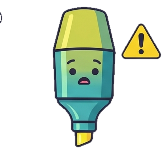
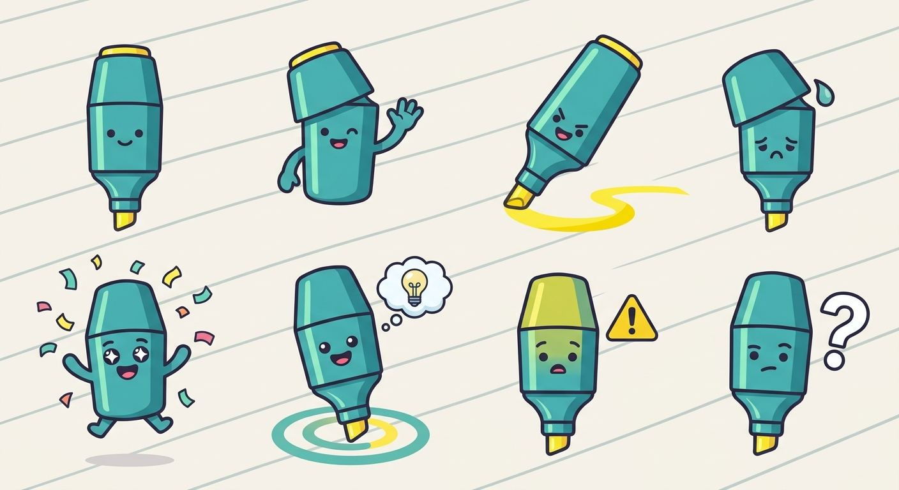

<p align="center">
  
</p>

<h1 align="center">Active Reading</h1>

<p align="center">
  <strong>Highlight with intent. Every highlight gets a role, a home, and a way back.</strong><br/>
  A Chrome extension for research reading — formerly <em>Context Highlighter</em>.
</p>

<p align="center">
  
  
  
  
</p>

---

Active Reading turns passive highlighting into an active research workflow. Instead of underlining everything in the same color and forgetting why, you decide **what role each fragment plays** while you read — a new topic, an idea, an argument, a piece of evidence — and file it under a color-coded **Context** (a research topic). Everything lands in a side panel where you can review it as rich Markdown, edit it like a document, and export it as notes or flashcards.

> The interface speaks Spanish (*Título*, *Idea*, *Argumento*, *Evidencia*). The idea is borrowed from classic study techniques like Cornell notes or SQ3R: classifying as you read is what converts a highlight into real understanding.

---

## How it works

<p align="center">
  
</p>

### 1 · Capture on any page

Select text anywhere on the web. A floating toolbar appears with one swatch per category:

- If the page already belongs to a Context, **one click saves instantly**.
- The **⋯** button opens the full capture popup: pick the Context, nest the note under any subtitle, and attach your own **comment** (rendered later as a Markdown quote).
- Lists keep their structure — `<ul>`/`<ol>` selections are captured as Markdown bullets and numbered items.

### 2 · Classify by meaning

| | Category | What it means | What it becomes |
|---|---|---|---|
| 🔴 | **Título** | A structural point — the start of a new topic or section | A `##` heading in your notes |
| 🟡 | **Idea** | A concept worth remembering, not yet connected | A note with a yellow left border |
| 🔵 | **Argumento** | The reasoning that connects ideas — *why* something holds | A note with a blue left border |
| 🟢 | **Evidencia** | A concrete fact, quote, or datum that backs an argument | A note with a green left border |

The category drives everything downstream: the on-page highlight color, the badge in the panel, and the emoji prefix that lets the Markdown export round-trip losslessly back into the extension.

### 3 · Review in the side panel

The side panel has two modes:

- **Vista** — a rendered Markdown preview of each Context, with items grouped under their source page. Each group header shows the site's hostname and jumps back to that page: if the tab is already open it gets focused, and once the page settles, the view scrolls to the exact highlight.
- **Editor** — a full Monaco editor with live sync, per-context buffers, `Cmd/Ctrl+S` to save, an undo/redo history across saves, *Format document* (`Shift+Alt+F`, via Markdown normalization), and find/replace (`Cmd/Ctrl+F`).

Prefer lighter editing? Double-click the Vista body to get a plain textarea of the raw Markdown with debounced auto-save.

### 4 · Highlights that survive

Highlights are anchored by text offsets and re-applied when you reload or revisit a page — and they degrade safely (no breakage) when the page's DOM has changed. PDFs get the same treatment, page by page.

## PDFs included

Chrome's native PDF viewer can't host content scripts, so Active Reading ships its own **pdf.js-based viewer** with a selectable text layer:

- A banner in the side panel offers *"Abrir en Active Reading"* whenever the current tab is a PDF.
- The extension icon's context menu does the same from anywhere.
- Capture works exactly like on the web: select text in the PDF, pick a category, done. Highlights re-anchor per page the next time you open the file, and notes carry their page number.

## Export your research

The **Exportar** menu grows by registry, not redesign:

- **Markdown** (`.md`) — the full document, including any unsaved edits in the live editor buffer.
- **Tarjetas Anki** (`.txt`, TSV) — one front/back card per idea, argument, and piece of evidence, plus a summary card per section, with tags ready for spaced repetition.

Everything is stored locally in `chrome.storage.local` — no accounts, no servers, no telemetry.

## Meet Penny

Penny is the teal highlighter pen who lives in the panel. You'll run into her whole emotional range:

| Penny | Where you meet her |
|---|---|
|  | **Waving** — greeting you when the panel opens |
|  | **Drawing** — keeping you company in the Vista while you read |
|  | **Confused** — the *"Lectura activa: cómo funciona"* onboarding modal, which explains the category system |
|  | **Warning** — asking you to confirm before deleting a Context |
|  | **Sad** — the rare "editor failed to load" state |
|  | **Celebrating** — off duty, reserved for future victories |

## Install from source

```bash
git clone <this-repo>
cd Context/vite-extension
pnpm install
pnpm run build      # produces dist/
```

Then in Chrome: `chrome://extensions` → enable **Developer mode** → **Load unpacked** → select `vite-extension/dist/`.

For live development with HMR: `pnpm run dev` and load the extension the same way.

## Development

```bash
cd vite-extension
pnpm run test        # Vitest — storage round-trips, export formats, bundling guards
pnpm run test:e2e    # Playwright — real Chromium, real chrome.storage, real text selection
pnpm run build       # production build to dist/
```

Project layout:

```
vite-extension/src/
├── content.js + capture/   # on-page capture UI (toolbar, popup, anchoring, painting)
├── viewer/ + viewer.html   # in-extension pdf.js viewer with per-page anchoring
├── sidebar/                # side panel modules (vista, editor, exports, onboarding…)
├── storage.js              # data layer over chrome.storage.local (+ Markdown contract)
└── background.js           # service worker: side panel, PDF context menu
```

Features are developed one at a time through a spec-driven pipeline
(Research → Spec → **human approval** → Test plan → Implement → Review) —
see [`AGENTS.md`](AGENTS.md) for how the harness works, and
[`feature_list.json`](feature_list.json) for the full feature history.
The `outputs/` directory is frozen legacy code kept for reference only.

---

<p align="center">
  <br/>
  <sub>Happy active reading.</sub>
</p>
